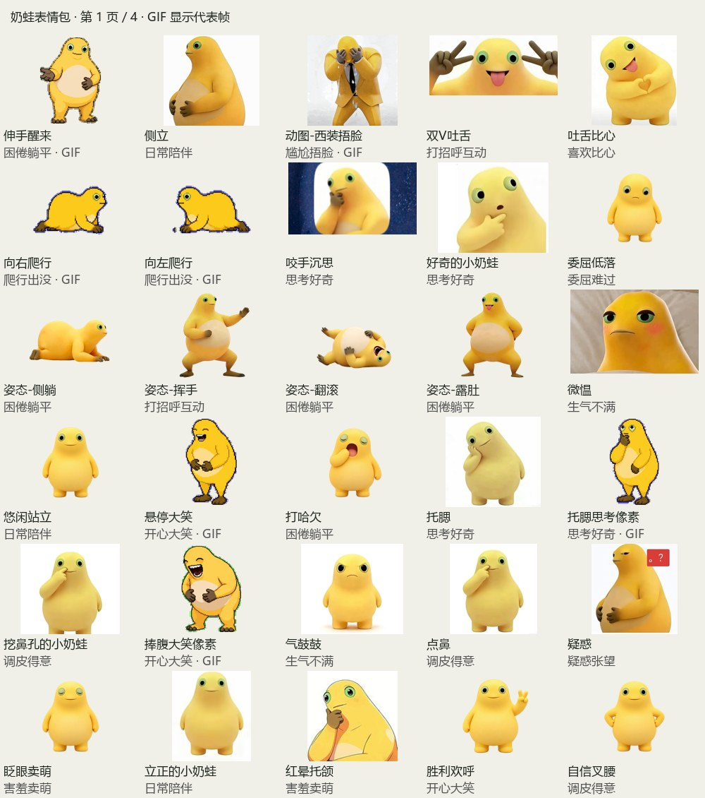

# 奶蛙表情包 · Naiwa Meme Pack

为 [AstrBot 表情包管理器](https://github.com/anka-afk/astrbot_plugin_meme_manager) 整理的资源包。

当前版本：**v1.1.0 · 按维护者人工筛选后的文件列表整理**。以剩余文件为准，未恢复已删除的候选图片。

**100 张表情 · 20 个动图 · 80 张静态图 · 17 个聊天语义类别**

## 从 GitHub 安装

AstrBot → 表情包管理器 → 资源广场 → 从 GitHub 安装：

- GitHub 仓库：`AkihaZhang/naiwa-meme-pack`
- 分支或版本：`main`
- 包所在目录：`.`

安装后，到设置中心 → 使用规则，将「奶蛙表情包」设为默认包，或绑定到指定会话/人格，然后保存。安装和浏览切换不会自动改变聊天选包规则。

这是表情资源包；在表情包管理器中安装，不在 AstrBot 的插件安装框中安装。

## ZIP 导入

可下载本仓库的 ZIP，或使用随附的 `naiwa-meme-pack-v1.1.0.zip`，在表情包管理器的导入功能中上传，检查包名与数量后确认。

## 分类

| 目录 | 用途 | 数量 |
| --- | --- | ---: |
| `happy` | 开心大笑 | 34 |
| `tease` | 调皮得意 | 9 |
| `thinking` | 思考好奇 | 5 |
| `confused` | 疑惑张望 | 1 |
| `sad` | 委屈难过 | 2 |
| `angry` | 生气不满 | 2 |
| `cute` | 害羞卖萌 | 4 |
| `love` | 喜欢比心 | 2 |
| `greeting` | 打招呼互动 | 3 |
| `sleepy` | 困倦躺平 | 8 |
| `surprised` | 震惊抱头 | 2 |
| `idle` | 日常陪伴 | 8 |
| `work` | 上班学习 | 7 |
| `food` | 吃喝围观 | 8 |
| `support` | 应援认亲 | 2 |
| `embarrassed` | 尴尬捂脸 | 1 |
| `moving` | 爬行出没 | 2 |

## 整理范围

来源是 [奶蛙艺术圣殿](https://github.com/Nailong-Studio/NaiLoong-Universe) 所指向的 [原图素材仓库](https://github.com/Nailong-Studio/wallpaper)，选取 `emotes/`、`laugh-gallery/`、`poses/` 与 `pet/` 的 4 个循环 GIF。

本版完全按维护者在候选图文件夹中保留的文件收录：117 个候选中保留 100 个，删除 17 个。删除与保留的原编号见 `selection.json`。角色辨识以维护者的筛选结果为准，不按原文件名自动断定角色。

保留原始文件字节、尺寸、透明通道、GIF 帧与播放时序；不加字、不裁切、不重新压缩。桌宠拆分静帧、壁纸、网页截图、视频与音频不在本包范围。

`semantic_metadata.json` 为插件 2.0 语义格式，提供逐图中文描述与标签，不附带本机向量。普通分类模式可直接使用；使用语义检索时可在本机按自己的嵌入模型建立索引。描述由整理过程按图片与原档案编写，并非声称经人工作者审核。

## 预览与来源

完整预览见 [previews/](previews/)。`inventory.json` 记录原路径、固定提交链接、尺寸、帧数、SHA-256、排除原因和分类；`attribution/` 保留每件素材的原始文字档案。

## 许可

素材版权归原权利人。请阅读 [LICENSE](LICENSE)、[上游来源说明](upstream/SOURCES.md) 和逐件档案；部分网络图片未标明独立素材许可，不将上游软件 MIT 许可直接套用于全部图片。遵守上游非商业使用说明，不出售素材。CC BY 4.0 等另有署名要求的素材保留其原作者与许可记录。

原图仓库提交：`b2898bc2a692897d1934623c2d0842eb035fc457`。整理日期：2026-10-29。维护者：AkihaZhang。
